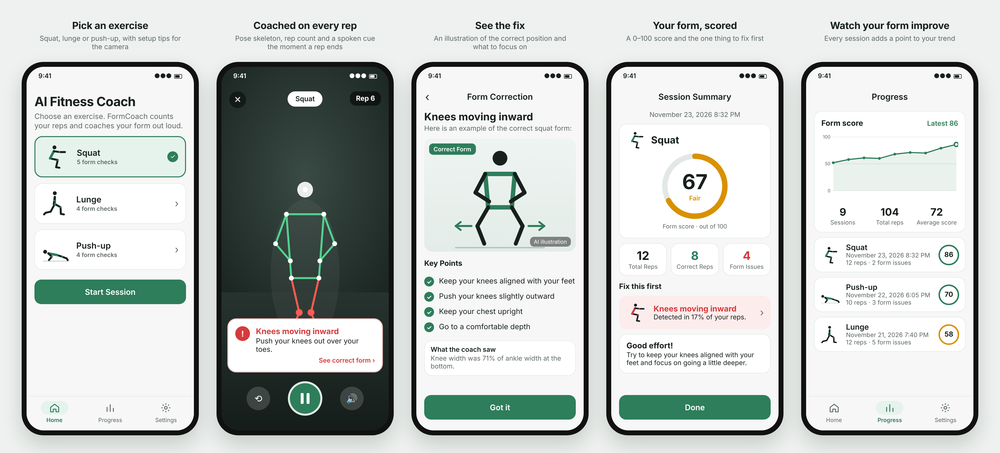

# FormCoach: Real-Time AI Fitness Coach

**CS 663 Project 2 · Group 1**: Marianna Belmares, Brent Paterson, Nico Savaides

A phone app that watches squats, lunges and push-ups through the camera, counts reps, detects form errors,
and coaches you out loud after each rep. Four models work together (details in `docs/architecture.md`):

| | Model | Job | Runs on |
|---|---|---|---|
| C | ML Kit BlazePose (pretrained) | body landmarks → rep counting, bottom-of-rep frame, crops, joint angles | phone |
| A | MobileNetV3-Large (fine-tuned) | which form error is visible at the bottom of the rep | phone (TFLite) |
| B | Gemini 3.5 Flash (fine-tuned) | evidence → one coaching decision: speak, praise, hold, or ask to reposition | Vertex AI via Cloud Run |
| D | Gemini 3.1 Flash Image (pretrained) | illustration of the corrected form | Vertex AI via Cloud Run |

Model development (training, fine-tuning, evaluation) is in **formcoach-models** (repository 2).
📄 Documentation report: *(link the PDF here)* · 🎥 Demo video: *(YouTube link)*

## The app



A clean, light Material 3 design: one brand green (`#2E7D5B`) for actions and good form, amber and red only for
form problems, white cards on a soft grey background, and large numbers for what matters. Dark mode uses the same
layout. The bottom bar has three tabs: **Home**, **Progress** and **Settings**.

| Screen | What you see | Code |
|---|---|---|
| **Home** | Pick squat, lunge or push-up, each with its number of form checks, then **Start Session**. A setup sheet shows where to put the phone. | `screens/home_screen.dart` |
| **Live coaching** | Full-screen camera with the pose skeleton (problem joints turn red), the rep count, and an alert card after each rep: the error, a short cue (also spoken), and **See correct form**. Switch camera, pause and mute below. | `screens/live_screen.dart` |
| **Visual Trainer** | An illustration of the correct position (Model D), the key points to focus on, and what the coach measured. | `screens/trainer_screen.dart` |
| **Session Summary** | A **0–100 form score** ring (share of reps with no form issue: 85+ Excellent, 70+ Good, 50+ Fair), total / correct / flagged reps, **Fix this first** (the most common issue), and overall feedback. | `screens/summary_screen.dart` |
| **Progress** | A form-score trend across your last 12 sessions, totals, and every past session with its score. Tap one to reopen its summary; swipe to delete. | `screens/history_screen.dart` |
| **Settings** | Audio cues, camera, theme, profile, the coach model (Tuned / Base / Rules, for the evaluation), form tips and help. | `screens/settings_screen.dart` |

The images above are design renders of these screens with example data (`docs/screens/mockups.html`, rendered by
`docs/screens/render.js`). Replace them with real screenshots from your phone once the app runs.

## Repository layout
```
mobile/     Flutter app (lib/vision = Models C+A + preprocessing, lib/coach = orchestration + backend client)
backend/    FastAPI service for Models B and D (Cloud Run)
scripts/    analyze_sessions.py (full-system evaluation), create_github_issues.sh
docs/       architecture, platform setup, evaluation protocol, plan, report outline
```

## Quick start
**Backend, locally, without Google Cloud** (rule-based coach so the app team can work before Gemini is tuned):
```bash
cd backend && pip install -r requirements.txt pytest httpx
python -m pytest -q tests                      # 11 tests, Gemini is faked
DEFAULT_COACH=mock uvicorn app.main:app --port 8080
```
**App:** open `mobile/` in Android Studio and press Run (full steps in `docs/platform_setup.md`).

**Training the models and adding them to the app:** follow the
[training guide](https://github.com/marimbel/formcoach-models/blob/main/docs/wiki/Training-Guide.md) in formcoach-models.

## Deploy the backend to Cloud Run
```bash
PROJECT=your-project; REGION=us-central1
gcloud services enable run.googleapis.com aiplatform.googleapis.com cloudbuild.googleapis.com --project $PROJECT
gcloud iam service-accounts create formcoach-api --project $PROJECT
gcloud projects add-iam-policy-binding $PROJECT --member serviceAccount:formcoach-api@$PROJECT.iam.gserviceaccount.com --role roles/aiplatform.user
cd backend
gcloud run deploy formcoach-api --source . --region $REGION --project $PROJECT \
  --service-account formcoach-api@$PROJECT.iam.gserviceaccount.com --allow-unauthenticated \
  --set-env-vars GOOGLE_CLOUD_PROJECT=$PROJECT,GOOGLE_CLOUD_LOCATION=$REGION,DEFAULT_COACH=tuned,TUNED_MODEL=projects/.../endpoints/...,API_KEY=choose-a-long-random-string
```
`--allow-unauthenticated` exposes the URL publicly; the `API_KEY` header check is what keeps strangers from using
your Vertex AI quota, so don't commit the key. Set a billing budget alert.

| Env var | Meaning |
|---|---|
| `DEFAULT_COACH` | `tuned` \| `base` \| `mock` (the app can override per session for base-vs-tuned demos) |
| `TUNED_MODEL` | tuned endpoint from `formcoach-models/runs/gemini/tuning_job.json` |
| `BASE_MODEL` / `IMAGE_MODEL` | defaults `gemini-3.5-flash` / `gemini-3.1-flash-image` (Gemini 2.5 was shut down on Vertex AI on Oct 20, 2026) |
| `THINKING_LEVEL` | `minimal` (fastest replies); `low`/`medium`/`high`, or empty to not send it |
| `COACH_TIMEOUT_S` | after this the backend answers with the rule-based fallback (default 6) |
| `SEND_IMAGE_TO_GEMINI` | send the 224 px bottom-of-rep crop with the evidence (default true) |

## API
`POST /v1/coach`: `{situation, image_jpeg_b64?, model?}` → `{action, error, cue, explanation, severity, visual_prompt, source, model_latency_ms}`
`POST /v1/trainer-image`: `{exercise, error, visual_prompt?}` → `{image_b64, source: generated|cache|static|none, prompt}`
`GET /healthz`

`backend/app/prompting.py` and `coaching_kb.py` are copies of files in formcoach-models; the tuned model must see
the same prompt format it was trained on. Check with `python ../formcoach-models/scripts/check_prompting_sync.py .`

## Privacy and safety
Video never leaves the phone. Per rep, only joint measurements and one 224×224 crop go to the backend for coaching;
the image model receives text only. The app is a fitness tool, not medical advice.
