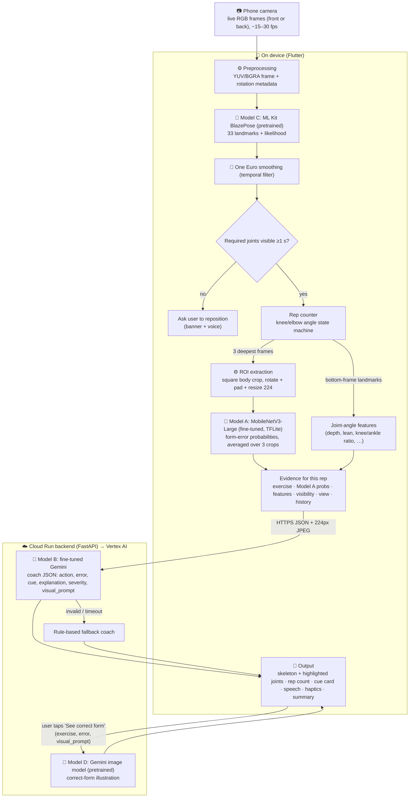

# System architecture

## Model specifications

| | Model A | Model B | Model C | Model D |
|---|---|---|---|---|
| **Model** | MobileNetV3-Large, ImageNet weights, new 13-way softmax head | Gemini 2.5 Flash (check current tunable list) + supervised fine-tuning (LoRA adapter) | ML Kit Pose Detection (BlazePose, base model), stream mode | Gemini 2.5 Flash Image |
| **Purpose** | Judges *appearance* of the body at the bottom of a rep → which form error | Turns all evidence into one safe, specific coaching decision; resolves uncertainty and contradictions; writes the illustration prompt | Finds body joints so we can count reps, find the bottom frame, crop the person and measure angles | Shows what correct form looks like for the detected error |
| **Input** | 224×224 RGB body crop (0–255) | Evidence JSON + bottom-of-rep crop (JPEG) | Camera frame + rotation | Text prompt (exercise, error, Gemini's `visual_prompt`); never the user's photo |
| **Output** | Probabilities over `exercise__error` classes, masked to the selected exercise | JSON `{action, error, cue, explanation, severity, visual_prompt}` | 33 (x, y, likelihood) landmarks | PNG illustration |
| **Location** | Phone (TFLite, background isolate) | Vertex AI, called via Cloud Run | Phone | Vertex AI, called via Cloud Run |
| **Customization** | Fine-tuned (compared with frozen-backbone baseline) | Fine-tuned (compared with base Gemini) | Pretrained | Pretrained |
| **Next step** | Evidence → Model B; highlight joints in UI | Cue spoken + shown; `visual_prompt` → Model D | Smoothing → rep counter, crops for A, features for B, skeleton overlay | Visual Trainer screen |

## Why each model is needed (no model is decorative)
- **C without A** can measure angles but not appearance cues that 2-D landmarks miss (heel lift under baggy pants,
  subtle valgus, depth when hips are occluded). `04b_feature_baseline.py` measures how much A adds over C's angles alone.
- **A without B** gives a label and a probability, not a decision. B decides *whether* to speak, handles low confidence
  or conflicting evidence, adapts to repeated errors and history, and phrases one short actionable cue.
- **D** answers "what should it look like?", which text cues alone don't.

## Timing budget (fill with measured numbers from session logs)
| Stage | Where | Target |
|---|---|---|
| Pose (C) per frame | phone | < 50 ms (≥ 15 fps) |
| Crop + Model A ×3 | phone | < 150 ms |
| Coach (B) round trip | cloud | < 2 s |
| Rep end → cue spoken | end-to-end | < 2.5 s |
| Trainer image (D) | cloud | 5–15 s (cached afterwards) |

## Failure handling
| Failure | What the app does |
|---|---|
| Body not visible ≥ 1 s | Pauses rep counting, banner + spoken reposition prompt |
| Model A file missing | Reps still counted; uniform probabilities → coach holds; "No Model A" chip |
| Model A unsure (< 50%) | Model B is trained to hold or give a low-severity cue |
| Model A vs angles disagree | Model B trained on `conflict` cases to hold or hedge |
| Gemini invalid JSON / timeout / quota | Backend returns rule-based reply, `source: fallback:<reason>` (logged) |
| Backend unreachable | App uses local cues, `source: offline:<reason>` |
| Image generation fails | Pre-generated static illustration, else a "couldn't create" message with retry |
